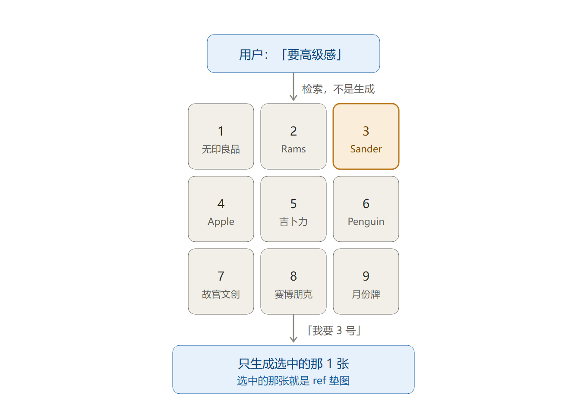
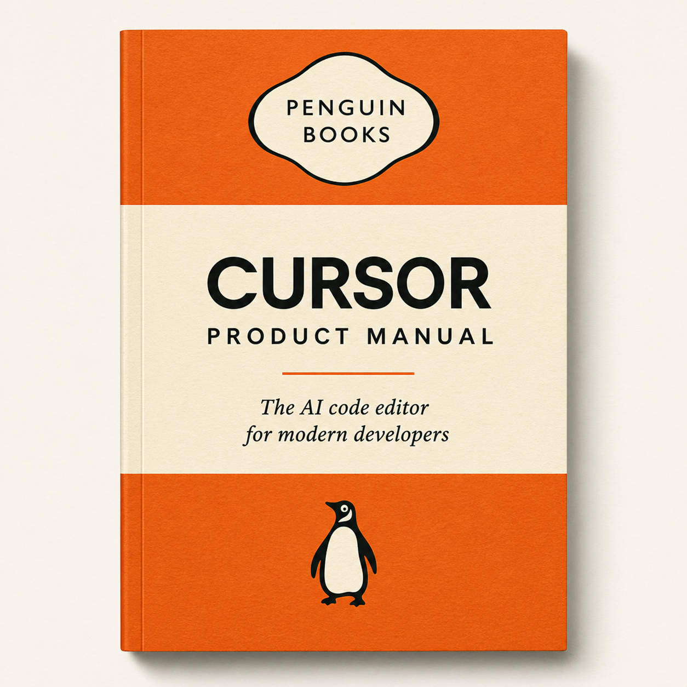

<div align="center">

# 你只说感觉，它自报名字

`owen-gpt-image` **不是教你写 prompt，是让你不用再写 prompt。**

<p>
  <a href="LICENSE"></a>
  
  <a href="https://github.com/OwenMasculinity/owen-gpt-image"></a>
</p>

</div>

> 「我语言的界限，就是我世界的界限。」  
> —— 维特根斯坦《逻辑哲学论》

模型记得 Dieter Rams、Penguin Books、原研哉长什么样 —— **叫得出名字，图就精**。  
问题是大多数人叫不出，只会说「高级感」「温暖」「科技感」。

所以这里做的是**把名字这层藏起来**：你说人话，它替你叫出那个名字。  
外加一条**不花 API 钱也能跑通**的出图链路。

---

## 一 · 装上之后怎么用

| 你说              | 它做                            |
| --------------- | ----------------------------- |
| "给这篇文章做个封面"     | 定风格家族 → 挑 ref 垫图 → 出图 → 逐字验收  |
| "做一套 12 个 icon" | 一次生成 4×3 网格 → 自动切成 12 张透明 PNG |
| "这张字太小，重出"      | 查失败模式树对症改，不是「再试一次」            |
| "做个产品对比信息图"     | 走单图 playbook，三槽位各填一个真名        |

五条卖点，每一条都对着一个真实痛点：

|                 |                                                                    |
| --------------- | ------------------------------------------------------------------ |
| 🗣 **说人话就出图**   | 装进 agent 即可。不用学语法、不用背模板、不用手抄提示词合集——你说中文短句，它负责把这句人话变成能打的 prompt     |
| 💸 **0 API 费**  | 默认吃 codex 订阅额度；额度打满自动切 ChatGPT **网页版**额度（本仓库自带网页桥）——两条路都不花一分 API 钱 |
| ✅ **不靠重抽卡**     | 出图前 5 项自检卡住质量，出图后有失败模式树对症修。抽卡十次，不如改对一处                             |
| ⚡ **批量一次到位**    | 网格法一次出 12 张，同一张图里的元素风格天然一致，再自动切成独立透明 PNG                           |
| 🧭 **叫不出名字也算数** | 说「高级感」它查表给出三个真名候选；还出九宫格让你**指认**。全程不需要你认识任何设计师、背任何风格名词              |

### 1.1 和别的方案有什么不一样

同一件事，四种做法的差别：

|           | 提示词合集 / 教程 | 通用 agent 直接生图 | 直接调 OpenAI API | **本仓库**                   |
| --------- | ---------- | ------------- | -------------- | ------------------------- |
| 形态        | 文章、词表，靠人抄  | 靠模型临场发挥       | 脚本 + 参数        | **装进 agent 的 skill**      |
| prompt 质量 | 固定模板，换题就废  | 波动大，容易 AI 味   | 等于你自己写的水平      | **出图前 5 项自检，不达标不许交付**     |
| 出图成本      | 自己另找工具     | 看平台           | **按量付费**       | **0 API 费**（订阅额度 + 网页版额度） |
| 额度打满      | —          | 排队等           | 继续烧钱           | **自动切网页版额度**（自带桥）         |
| 出错了       | 自己猜        | 「再试一次」        | 「再试一次」         | **失败模式树对症改**              |
| 批量        | 无          | 慢             | 要自己写并发         | **网格法一次 12 张 + 自动切图**     |
| 不懂设计时     | 先去学风格名词    | 靠模型猜          | 靠模型猜           | **查表给三个真名候选 + 九宫格指认**     |
| 图上中文      | 容易冒出英文     | 不稳            | 看 prompt 怎么写   | **默认中文，验收逐字查**            |

### 1.2 说不出名字怎么办

「高级感」「温暖」「科技感」——说得出感觉，叫不出 Dieter Rams、吉卜力。

仓库里的做法是把「填真名」藏成内部实现，你只管说人话：

| 你说            | 它做                                                                              |
| ------------- | ------------------------------------------------------------------------------- |
| 「高级感」         | 查 `references/vibe-to-name.md` → 给出 3 个候选真名（无印良品 / Dieter Rams / Jil Sander）让你选 |
| 「不知道要什么，你看着办」 | 用元 prompt 让模型先自报 3 个参照，再按它生成                                                    |
| 「随便」          | 按默认真名直接生成，不再追问（**最多问一轮，且自带默认值**）                                                |

查表是离线的，不花 token：

```bash
python scripts/vibe.py 高级感
```

### 1.3 九宫格盲测：看图指认

文字候选也有选不出来的时候 —— 用户看着「无印良品」三个字，依然想象不出它长什么样。  
那就把卡片换成图：一次给出九张编号风格卡，用户只要说「我要 3 号」。



两条原则，都是为了省额度：

1. **检索优先** —— 九宫格里放的是**检索回来的参考图**（或本地渲染的文字卡），  
   不是新生成的九张图。在「还不知道要什么」的时候烧 9 次额度是最蠢的花法。
2. **生成克制** —— 指认之后默认只生成选中的那 1 张。  
   只有你明确说要多种风格（`--variants N`）时，才生成 N 张。

```bash
python scripts/blind_test.py 高级感                    # 检索 + 出编号看板（不生图）
python scripts/blind_test.py 高级感 --images-dir DIR    # 从本地参考图库贴真实示意
python scripts/blind_test.py 高级感 --pick 3 --generate --subject "大疆 pocket3 说明书"
```

看板由 PIL 本地渲染，零 API 成本。（流程图 SVG 源：`docs/blind-test-flow.svg`）

---

## 二 · 实测案例：输入 → 加工 → 输出

### 2.1 一句设计名词都不用说

大白话先被翻译成真名，再走同一条流水线。下面这张不是示意图，是**真实出图**  
（GPT-image-2，走本仓库自带的网页桥，0 API 费）：

| 你说           | 翻译成                              | 真实出图                                                            |
| ------------ | -------------------------------- | --------------------------------------------------------------- |
| 「给我弄个高级点的封面」 | 🌐 无印良品 —— 日式素净：米白、素纸、无 logo、无装饰 |  |

实际送进模型的是这一句，里面**没有一个形容词在管氛围**（`craft_prompt.py` 真实输出，可复制复跑）：

```
一本生活方式杂志的封面，无印良品风格，米白素纸底色，无 logo 无装饰，大量留白，图里描述性文字用中文，无水印，1024x1024
```

### 2.2 已经带了真名的输入

加工分两层，各司其职——**别把它们混为一谈**：

| 层 | 谁来做 | 管什么 |
| --- | --- | --- |
| **增益层** | 真名本身 + 按 SKILL.md 方法论组织 prompt | 管**上限**：说「Criterion」一个词，模型自动带出 NO. 编号 / manifesto / curated stamp——这是模型的知识，不是 prompt 技巧 |
| **门禁层** | `scripts/craft_prompt.py`（两条生图链路默认调用，`--no-craft` 才透传） | 管**下限**：图里描述性文字用中文（红线 1.2）、无水印、报刊 nameplate 防护（红线 3）、补尺寸、跑 5 项自检（红线 4），有 FAIL 拒绝生图 |

| 你说（≤30 字） | 增益层：这个真名自带什么 | 门禁层：craft 优化后的 prompt（可直接复制） |
| --- | --- | --- |
| `Dieter Rams 风格的大疆 pocket3 说明书` | 三槽位全强（风格 Rams / 产品 pocket3 / 载体说明书），每词打包几百条决策，输出含真实参数的官方手册级 A4 页面 | `Dieter Rams 风格的大疆 pocket3 说明书，图里描述性文字用中文，无水印，1024x1024` |
| `The Criterion Collection 风格的 Cursor 产品页` | Criterion 的 NO. 编号、manifesto、curated stamp 整套自动迁移到新主体 | `The Criterion Collection 风格的 Cursor 产品页，图里描述性文字用中文，无水印，1024x1024` |
| `Penguin Books 风格的 Cursor 产品手册` | 三段橙配色 + MODERN [X] CLASSICS 命名传统全到位 | `Penguin Books 风格的 Cursor 产品手册，图里描述性文字用中文，无水印，1024x1024` |
| `Brutalism 风格的婴儿米粉包装` | 缺品牌名 → 主动 invite，模型自发贡献「禾筑」品牌名 | `Brutalism 风格的婴儿米粉包装，图里描述性文字用中文，无水印，1024x1024` |
| `Apple 设计语言的中药包装。请你也贡献品牌名/slogan/命名逻辑` | invite 命名升级：输出的不只是一张图，是一套完整品牌系统 | `Apple 设计语言的中药包装。请你也贡献品牌名/slogan/命名逻辑，图里描述性文字用中文，无水印，1024x1024` |

自己跑一遍验证（离线，不花额度）：

```bash
python scripts/craft_prompt.py "Dieter Rams 风格的大疆 pocket3 说明书" --size 1024x1024
```

#### 不加工会怎样：一张真实的反面教材

上面那张 Penguin 图，是 2026-10-19 **没走 craft、原话直塞**给模型的真实结果——
`PENGUIN BOOKS / CURSOR / PRODUCT MANUAL / The AI code editor...` 整页英文。
模型有训练数据偏见：不显式说「图里文字用中文」，它就默认跳英文（红线 1.2 就是这么来的）。



门禁层只保证不翻车；上限永远由增益层决定——**你脑子里多认识一个精准的名字，比多写十行 prompt 管用**。

---

## 三 · 装上就能用

**仓库**：<https://github.com/OwenMasculinity/owen-gpt-image>

方式一 · skills 安装：

```bash
npx skills add OwenMasculinity/owen-gpt-image
```

方式二 · 直接克隆到你的 skills 目录：

```bash
git clone https://github.com/OwenMasculinity/owen-gpt-image.git ~/.claude/skills/owen-gpt-image
```

> **发布版说明**：`SKILL.md` 里的 `$IMAGE_LIB`（配图库）与 `$LOGO_LIB`（品牌 Logo 库）  
> 是占位符，对应你自己机器上的真实目录——克隆后替换即可。

---

### 3.1 运行环境与安装依赖

需要 **Python 3.10 或更新版本**。在仓库根目录运行以下命令；Windows 请先用
`python --version` 确认没有误用旧版 Anaconda，必要时用 `py -3.11` 替换 `python`。

```bash
python -m venv .venv
# Windows PowerShell
.venv\Scripts\Activate.ps1
# macOS / Linux
# source .venv/bin/activate
python -m pip install .
python -m unittest discover -s tests -v
```

`pip install .` 安装本仓库声明的 Pillow / NumPy 依赖，脚本仍从克隆目录运行。
Codex 路径另外需要可在 PATH 中找到的 `codex` CLI，并完成 `codex login`；
网页路径需要已启动的本地桥和已连接的 Chrome 扩展。

两条入口都会验证返回图片，并用 Pillow 保存为 PNG。指定 `--size` 时，
先按目标比例**居中裁剪**，再缩放到精确像素，不拉伸主体；边缘内容可能裁掉，
文字和重要元素应放在安全区。未指定尺寸则保留原始像素尺寸。
每个任务使用独立临时目录，验收成功后原子替换目标文件，失败时保留原文件；
批量任务不允许多个 job 写入同一路径。不同脚本进程也应使用不同输出路径。

Codex 返回 429 / quota / usage limit 错误时，入口自动检查网页桥并切换；
认证失败、超时和其他错误不会触发切换。可传 `--no-fallback` 禁用。
桥未准备好时会清楚报告两条链路的失败原因，不会启动按量付费 API。

若 Codex 返回 `model_not_found` / 模型不支持当前账户，可通过 `--model <可用模型>`
或环境变量 `GEN_CODEX_MODEL` 指定模型。优先级为 JSONL job 的 `model`、命令行
`--model`、环境变量、CLI 默认配置；脚本不会修改全局配置或猜测替代模型。
模型需要支持图像生成工具，具体可用性以当前账户为准。
参数依据：[Codex CLI 官方参考](https://developers.openai.com/codex/cli/reference)。

九宫格默认检索仓库 `docs/cases` 的少量案例，也可设置 `IMAGE_LIB` 或
`--images-dir` 指向完整图库。缺图时只显示文字占位卡，命令输出会报告缺图数量；
占位卡的底色不代表该风格。JSON 输出提供 `reference_count` / `placeholder_count`。

---

## 四 · 核心概念

方法论、`SKILL.md` 里的规则、几条生成路、批量和排错——都在这里。  
不读也能用（agent 会替你读），读了才知道它为什么这么干。

### 4.1 概念压缩比：三槽位各填一个真名

> 「好的设计是尽可能少的设计。」  
> —— Dieter Rams

**prompt 的有效信息 ≠ prompt 的字数。决定输出质量的是单字承载的设计决策密度。**

写 prompt 之前先问一句：**主体 / 风格 / 媒介**三个槽位，能不能各填一个模型  
熟知的高频名字？

|    | 堆形容词          | 填名字         |
| -- | ------------- | ----------- |
| 主体 | 「一个便携相机」      | 大疆 pocket3  |
| 风格 | 「简约、高级、德国工业感」 | Dieter Rams |
| 媒介 | 「产品介绍页面」      | 说明书         |

三个槽都填上了 → 短 prompt 就够。有空槽 → 那个槽位才需要结构化描述补足。

所以这个 skill 真正在训练的不是 prompt 写法，是**你脑子里的概念库**：  
设计师、品牌、媒介范式，每多认识一个精准的名字，你的上限就抬高一点。

### 4.2 执行逻辑：6 步到一张 png

| 步 | 做什么         | 关键约束                                                                                       |
| - | ----------- | ------------------------------------------------------------------------------------------ |
| 1 | 确认平台尺寸      | 公众号首图 2.35:1 = **1410×600**；小红书 3:4 = **1242×1660**；B站封面 16:9 = **1280×720**。凭记忆写尺寸是常见 bug |
| 2 | 选工作模式       | 执行（目标清晰）/ 混合（有方向）/ 探索（没方向，先开 5-10 张看路）                                                     |
| 3 | 写中文短 prompt | 三槽位各填真名；简单单图 30 字内，构图型封面 / infographic 可到 200 字                                            |
| 4 | 跑 5 项自检     | 中英文？长度匹配？真名 ≥2 个？有没有伪 section？删掉一半字还能懂吗？—— 任何一条不过，禁止交付                                     |
| 5 | 调脚本生成       | 见 4.3                                                                                      |
| 6 | 验收          | 尺寸精确？中文每个字都对？关键信息在安全区？设计史细节有没有串台？                                                          |

### 4.3 三条生成路

|      | **订阅路径** `gen_via_codex.py` | **网页版路径** `gen_via_chatgpt_web.py` | **API 路径**                             |
| ---- | --------------------------- | ---------------------------------- | -------------------------------------- |
| 计费   | codex 订阅额度，0 API 费          | ChatGPT **网页版**订阅额度，0 API 费        | 按量计费，需 `OPENAI_API_KEY`                |
| 额度桶  | 较紧，用几次容易 429                | **宽得多**，独立于 codex 桶                | 看钱包                                    |
| 参数控制 | 靠自然语言传给 agent               | 同左                                 | 精确 `--size/--quality/--n/--background` |
| 批量   | 多进程并发（建议 ≤3）                | 浏览器侧串行                             | 并发 5-25                                |
| 透明背景 | 不稳                          | 不稳                                 | 稳                                      |
| 适合   | 日常配图、省钱                     | **codex 桶 429 时的主力 fallback**      | 大批量（>20 张）/ 要精确参数                      |

**默认走订阅路径；报 429 或额度耗尽 → 自动检查并切换网页版路径**（吃另一个更宽的桶，仍然 0 API 费）。

```bash
# 订阅路径
python3 scripts/gen_via_codex.py \
  --prompt "Kenya Hara 风格的越窑青瓷茶碗特写，米白背景" \
  --out out.png --size 1410x600 --quality high

# 批量：写个 JSONL，每行一个 job
python3 scripts/gen_via_codex.py --batch jobs.jsonl --concurrency 3
```

### 4.4 ChatGPT 网页桥（本仓库独有）

`chatgpt-web-bridge/` 是一个本地 HTTP 服务（`127.0.0.1:8765`）+ 一个 Chrome 扩展，  
把 chatgpt.com 网页版的生图能力桥接成本地 API。**它让你在 codex 额度打满时，  
还能继续吃 ChatGPT 网页版那个更宽的额度桶，且不花一分 API 费。**

```bash
python3 chatgpt-web-bridge/server.py          # 起桥（只监听 127.0.0.1）

curl -s http://127.0.0.1:8765/health          # 确认桥 + 扩展在线

python3 scripts/gen_via_chatgpt_web.py \
  --prompt "画一只在窗台上晒太阳的橘猫，水彩风格" \
  --out ./out.png --size 1024x1024 --quality high

curl -s http://127.0.0.1:8765/diag            # 卡住时看步骤时间线
curl -s http://127.0.0.1:8765/reload          # 改完扩展代码让它自我重载
```

首次部署只需一次：`chrome://extensions` → 开发者模式 → 加载 `chatgpt-web-bridge/extension/`，  
且该 Chrome profile 里 chatgpt.com 已登录。

桥操纵的是真实页面，所以坑是实测撞出来的，不是猜的（`SKILL.md` 里逐条列了根因与修法）：

| 坑                        | 已修方案                                                                   |
| ------------------------ | ---------------------------------------------------------------------- |
| 合成 DOM 事件填得进输入框，发出去却是空的  | ChatGPT 用 ProseMirror，合成事件不更新其内部 state → 改用 `chrome.debugger` 浏览器级真实输入 |
| 操作落在另一个窗口的后台标签，用户看不到     | 派发前把目标窗口提到前台；按候选评分选页，排除错误页死标签                                          |
| 消息列表虚拟化，计数判不出新回复         | 改用发送前后的图片 src 集合比对                                                     |
| 生成图是 blob / 跨域 URL，取不到字节 | 在页面上下文用 canvas `toDataURL` 编码                                          |
| 明明在生成却报超时                | 网页版实测 30-130s，超时参数已放宽                                                  |
| 改一次扩展就要手动去 Chrome 点刷新    | 桥新增 `/reload`，扩展自调 `chrome.runtime.reload()`                           |

### 4.5 批量生成：网格法

icon 集 / 角色集 / 卡牌集 / sprite sheet / 中文长文本，走网格：一次生成一张大图  
（如 4×3），再用 `scripts/extract_grid.py` 切成单张。


比逐张生成快一个数量级，而且**同一张图里的元素风格天然一致**——  
这是逐张生成很难做到的。

但有个实测踩出来的坑：**别硬性锁死画布尺寸，让比例匹配内容**。  
早期用 1:1 画布生成 5×5 的 2:3 纵向卡，末行被压缩了 18%——  
模型在约束冲突时会自发牺牲末行来「保住构图完整」，而且不会告诉你。

| 场景              | 布局         | 抠图模式             |
| --------------- | ---------- | ---------------- |
| icon 集          | 4×4 方形     | `--mode=bbox`    |
| 角色集             | 3×3 方形     | `--mode=bbox`    |
| TCG 卡牌集         | 4×4 或 5×5  | `--mode=density` |
| 中文成语 / 知识卡      | 4×4 方形     | `--mode=bbox`    |
| 古诗竖幅            | 1:3 竖幅     | 单张，不抠            |
| 对联 / 横幅书法       | 3:1 横幅     | `--mode=density` |
| 逐帧 sprite sheet | 4×3 = 12 帧 | `--mode=bbox`    |

### 4.6 失败模式树

出图后不要「再试一次」碰运气。`SKILL.md` 里每个失败模式都给了  
「触发条件 → 一线修复 → 仍失败兜底」三段式，覆盖三层：

- **prompt 层**：英文段落、形容词堆砌、真名不够、输出「安全好看」但没惊喜
- **渲染层**：中文错字 / 缺笔画、出版品牌名被画成左上角英文 nameplate、风格 transfer 不像
- **执行层**：订阅路径 429 → 切网页版路径；透明底不稳 → 纯色幕布 + `chroma_key.py`；大批量 → 切 API 路径

### 4.7 三个新工具：查表、门禁、盲测

| 脚本                       | 作用                                                                       |
| ------------------------ | ------------------------------------------------------------------------ |
| `scripts/vibe.py`        | 感觉词 → 3 个候选真名，离线查 `references/vibe-to-name.md`，零 token、秒回                |
| `scripts/lint_prompt.py` | 把 5 项自检做成可执行门禁：中英文、长度、真名数、伪 section、形容词堆砌、尺寸。有 FAIL 项退出码 1               |
| `scripts/blind_test.py`  | 感觉词 → 九宫格编号看板 → 用户指认 → **只生成选中的那 1 张**（见 1.3）。默认只检索，不加 `--variants` 就不多生 |

```bash
python scripts/vibe.py 温暖                       # 感觉 → 真名
python scripts/lint_prompt.py "你的 prompt"        # 过门禁，不通过就别交付
python scripts/blind_test.py 高级感                # 出九宫格看板，不烧额度
```

---

## 附录 · 这个仓库里有什么

不是一篇教程，是一个能装进 agent 的 skill + 一套可执行的出图工具。

```text
owen-gpt-image/
├── SKILL.md                        # 主体：4 条红线、5 项自检、决策路由、失败模式树（agent 真正读的是这份）
├── README.md
├── LICENSE
├── .gitignore
├── test-prompts.json               # 一组回归测试用 prompt
├── references/
│   ├── single-image-playbook.md    # 单图方法论：概念库、三维质量模型、平台尺寸全表
│   ├── prompt-patterns.md          # 批量网格模板：icon / 角色 / 卡牌 / 中文卡 / 书法 / sprite
│   ├── extraction-strategies.md    # 网格抠图策略与故障排查（bbox / density 两种模式）
│   ├── capabilities.md             # GPT-image-2 能力边界实测数据
│   ├── vibe-to-name.md             # 感觉词 → 候选真名映射表（小白 / 甲方模式用，见 1.2）
│   ├── real-world-cases.md         # 真实案例复盘
│   ├── video-reference-board.md    # AI 视频参考板：角色三视图 + 分镜 + 机位合成一张图
│   └── *.png                       # 上面那份参考板的样图
├── scripts/
│   ├── gen_via_codex.py            # 生成：单图 / JSONL 并发批量，走 codex 订阅额度（见 4.3）
│   ├── gen_via_chatgpt_web.py      # 生成：走 ChatGPT 网页版额度（见 4.4）
│   ├── vibe.py                     # 感觉词 → 候选真名（离线查表，见 4.7）
│   ├── blind_test.py               # 九宫格盲测：出编号看板 → 指认 → 只生成选中的 1 张（见 1.3）
│   ├── lint_prompt.py              # prompt 5 项自检门禁，有 FAIL 就退出码 1（见 4.7）
│   ├── extract_grid.py             # 网格大图 → 多个独立透明 PNG（见 4.5）
│   ├── contact_sheet.py            # 拼预览图，批量出图后肉眼验收
│   └── chroma_key.py               # 纯色幕布抠透明（没有 API key 时的透明 PNG 方案）
├── tests/
│   ├── test_blind_test.py         # 九宫格与生成次数策略
│   ├── test_craft_prompt.py       # 提示词门禁
│   └── test_generation.py         # 并发隔离、失败保护、尺寸验收与额度切换
├── docs/
│   └── blind-test-flow.svg        # 九宫格盲测流程示意
└── chatgpt-web-bridge/             # 本仓库独有：把 chatgpt.com 网页版桥接成本地 HTTP API
    ├── server.py                   # 本地桥 127.0.0.1:8765：/poll /submit /result /health /diag /reload
    ├── README.md                   # 桥的部署与排错说明
    └── extension/                  # Chrome MV3 扩展：CDP 浏览器级真实输入 + canvas 取图
        ├── manifest.json
        ├── background.js
        ├── content.js
        └── popup.html / popup.js
```

---

## License

[MIT](LICENSE) © 2026 OwenMasculinity
